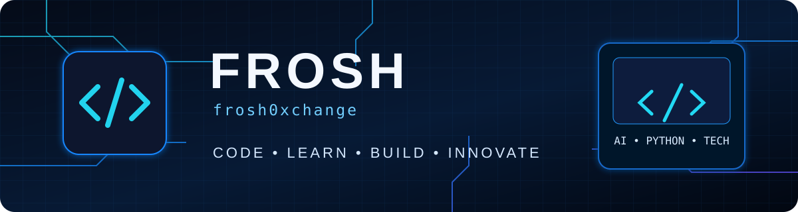

### Building ideas into useful technology.

**Education & Computer Science Student · Tech Enthusiast · Aspiring AI Developer**

---

## > whoami

Hi, I'm **Frosh**. I study **Education and Computer Science**, and I'm passionate about technology, exploring how things work, and building useful digital experiences.

I'm especially curious about artificial intelligence, programming, software development, and the ways technology can improve learning and everyday life. I learn best by experimenting, building projects, and improving one step at a time.

- 🔭 **Building:** NEXORA AI, my personal local AI assistant.
- 🌱 **Learning:** Python, desktop application development, and AI workflows.
- 🧠 **Exploring:** Local language models with Ollama and Qwen3 1.7B.
- 💡 **Interested in:** AI, software development, educational technology, and emerging tech.
- 🎯 **Goal:** Turn ideas into practical technology while growing as a developer.
- 🤝 **Open to:** Learning, collaboration, and beginner-friendly open-source contributions.

## > featured_projects

<table>
<tr>
<td width="50%" valign="top">

### 🤖 NEXORA AI
**Personal AI assistant · In development**

A Python-based assistant powered by a local language model through Ollama. The working prototype responds to messages and can speak through the laptop's speakers. The project is growing toward a polished desktop assistant.

**Stack:** Python · Ollama · Qwen3 1.7B

</td>
<td width="50%" valign="top">

### ⚙️ OS Synchronization Practicals
**Operating systems coursework**

A repository for practical work related to operating-system synchronization concepts.

[**Open repository →**](https://github.com/frosh0xchange/os-synchronization-practicals)

</td>
</tr>
<tr>
<td width="50%" valign="top">

### 💻 Frosh
**Learning and coding repository**

My public repository for sharing coding work and continuing my development journey.

[**Open repository →**](https://github.com/frosh0xchange/Frosh)

</td>
<td width="50%" valign="top">

### 🔐 Python Login App
**Earlier learning project**

A beginner Tkinter login-interface project created while learning Python GUI development. Further improvements and packaging are planned.

</td>
</tr>
</table>

## > tech_stack

| Area | Tools & technologies |
|:--|:--|
| Languages | Python · C++ *(learning)* |
| AI & local models | Ollama · Qwen3 |
| Development | VS Code · Git · GitHub |
| GUI exploration | Python Tkinter |
| Interests | Artificial intelligence · EdTech · Software · Emerging technology |

## > currently_focused_on

- [ ] Improve Python and software-development fundamentals.
- [ ] Build a desktop interface for NEXORA AI.
- [ ] Organize and document project repositories.
- [ ] Explore practical AI tools for education and productivity.

## > github_activity

---

**“Code. Learn. Build. Innovate.”**

*One project, one lesson, and one improvement at a time.*

